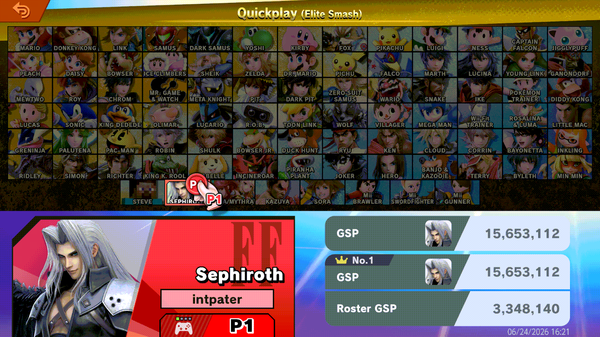
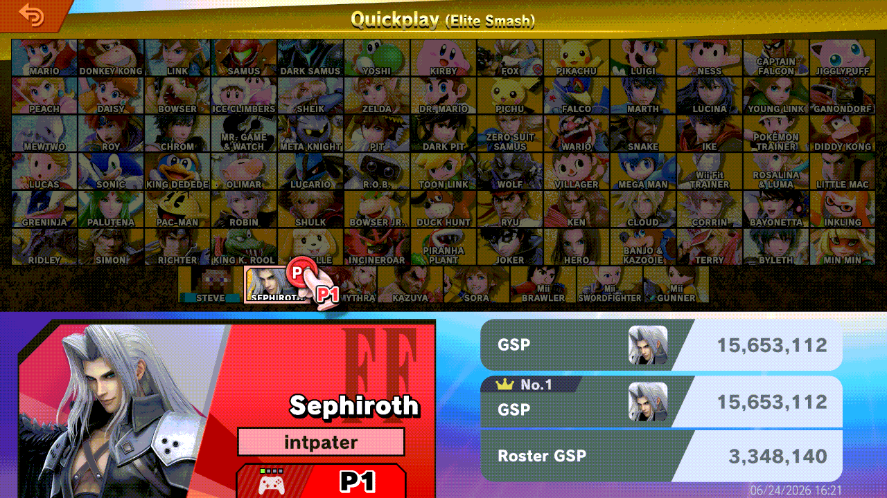

# ssbu-quiet-elite-switch

> **Disclaimer:** this project was developed with the assistance of AI
> (Claude, Codex and other coding agents) under the operator's direction and
> review. Nothing is claimed beyond the dated tests cited below.

A Skyline plugin for Super Smash Bros. Ultimate 13.0.5. On the Quickplay
character select, switching from a fighter in Elite Smash to one that is not
brings up a pop-up. This plugin stops that pop-up; the screen still switches
back from the Elite Smash colours.

**Before** (no plugin):



**After** (with the plugin):



*Eden, 2026-10-30, runs e13 (no plugin) and e14 (0.1.0, NRO `8e08dbd4…`):
Sephiroth is in Elite Smash, so the character select opens as Quickplay
(Elite Smash). Selecting him, then Pyra/Mythra (not in Elite Smash): without
the plugin the game stops on "You haven't unlocked Elite Smash with this
fighter. Returning to standard matchmaking."; with it, the screen goes
straight back to Quickplay and Ready to Fight.*

- It changes nothing unless the game is 13.0.5 and the code it hooks is the
  13.0.5 code, or another plugin's hook on it.
- It keeps working next to other plugins that hook the same spot.
- Small: 40 KiB of game memory once loaded (code and data), no heap use.
- UI only: no rating, network or match state changes.

Tested in Eden (2026-10-30/31) and on a Switch (2026-11-02). 0.2.0 is the
build on the Switch card (read back 2026-11-12). Details:
[docs/EVIDENCE.md](docs/EVIDENCE.md); how the hook works:
[docs/HOOK.md](docs/HOOK.md).

## Install

There is no published release. Build it (below), then copy
`target/aarch64-skyline-switch/release/libssbu_quiet_elite_switch.nro` to
`sd:/atmosphere/contents/01006A800016E000/romfs/skyline/plugins/`. The
install line goes to `sd:/ultimate/ssbu-quiet-elite-switch/events.log`.

## Build

```text
cargo test
cargo skyline build --release
```

## License

MIT; see [LICENSE](LICENSE).
