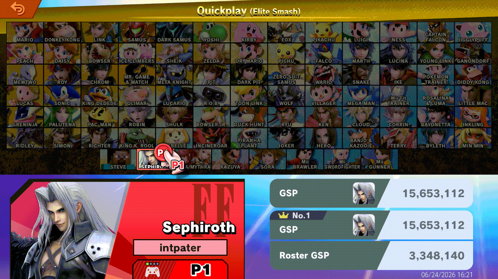
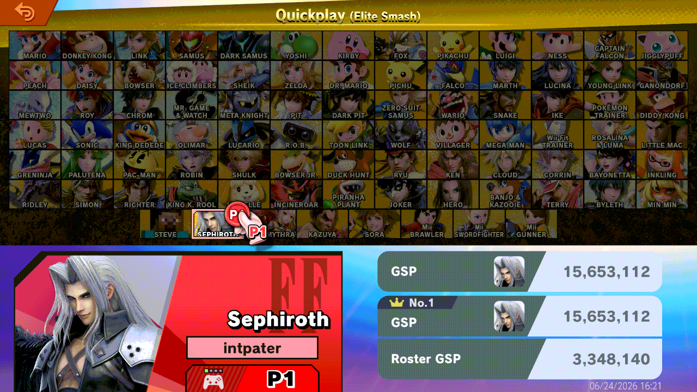

# ssbu-quiet-elite-switch

> **Disclaimer:** this project was developed with the assistance of AI
> (Claude, Codex and other coding agents) under the operator's direction and
> review. Nothing is claimed beyond the dated tests cited below.

A Skyline plugin for Super Smash Bros. Ultimate 13.0.5. On the Quickplay
character select, switching from a fighter in Elite Smash to one that is not
brings up a pop-up. This plugin stops that pop-up; the screen still switches
back from the Elite Smash colours.

**Before** (no plugin):



**After** (with the plugin):



GIF_CAPTION

- One hook, guarded: it installs only on 13.0.5 with the hooked code
  unchanged ([details](docs/HOOK.md)).
- **No clashes:** if another plugin wants the same instruction, the two
  share one hook through `ssbu_inline_site_1a1caa8_v1` (found with
  `nn::ro::LookupSymbol`, any load order) and both keep working.
- UI only: no rating, network or match state changes.

## Install

Copy `libssbu_quiet_elite_switch.nro` to
`sd:/atmosphere/contents/01006A800016E000/romfs/skyline/plugins/`. The
install line goes to `sd:/ultimate/ssbu-quiet-elite-switch/events.log`.

## Build

```text
cargo test
cargo skyline build --release
```

## License

MIT
